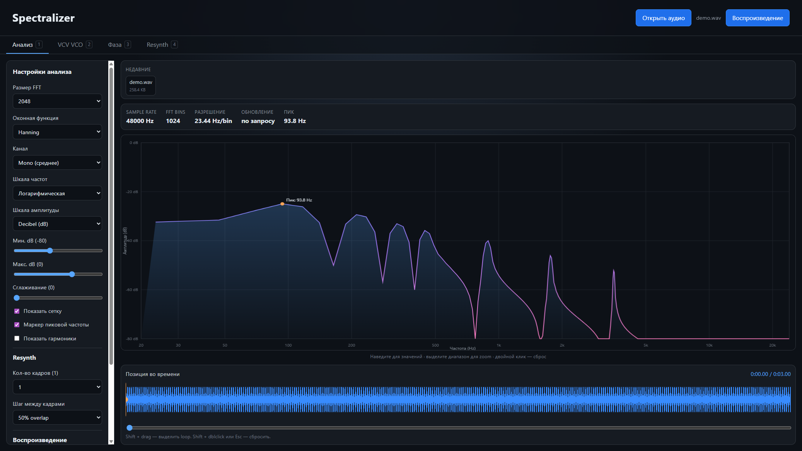
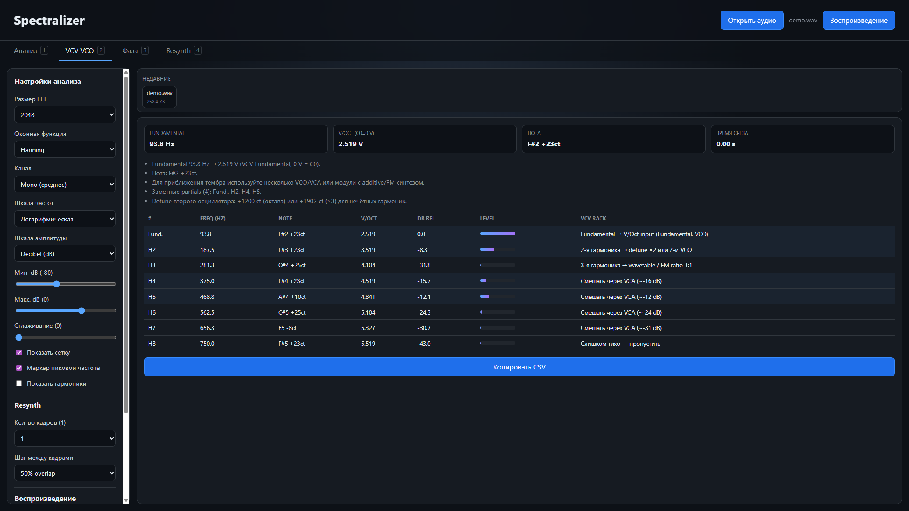
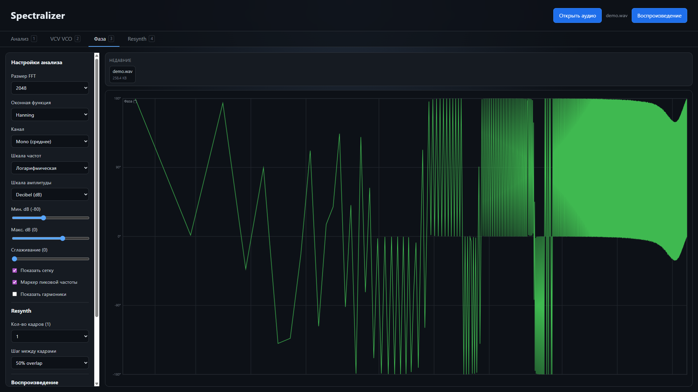
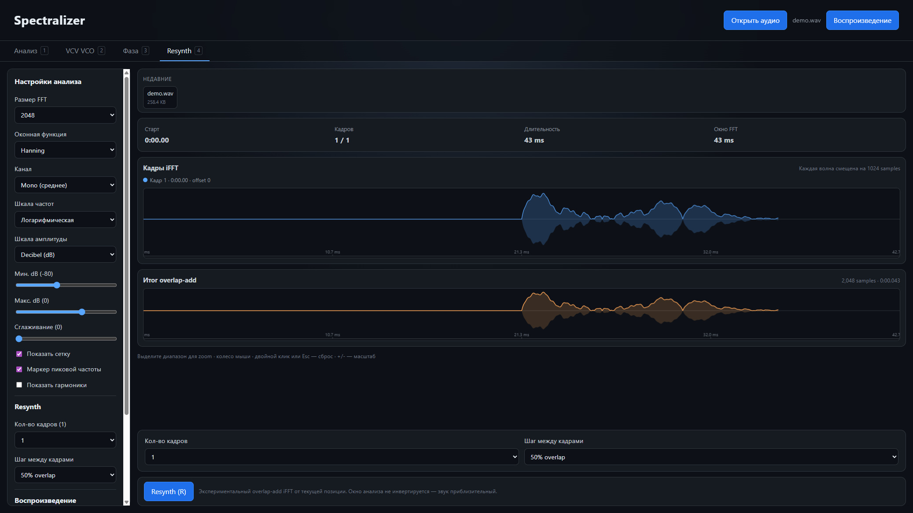
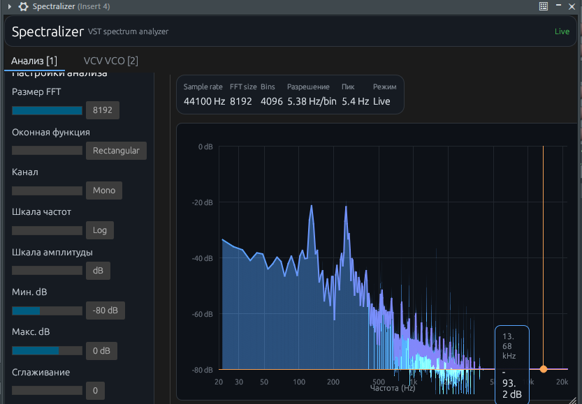

# Spectralizer

Анализатор частотного спектра: **десктоп** для файлов и **VST3/CLAP** для DAW.

Нужен, когда надо не «на глаз», а по FFT: из чего состоит сэмпл, где fundamental, какие обертона, что происходит на дорожке во время Play.

| | Desktop | VST / CLAP |
|---|---|---|
| **Задача** | Разобрать загруженный файл | Смотреть спектр входа DAW |
| **Кому** | Саунд-дизайн, разбор тембра, VCV Rack, учёба DSP | Сведение, проверка дорожки, freeze на Stop |
| **Звук** | Воспроизведение файла | Pass-through, сигнал не меняется |

📦 [Скачать v1.0.0](https://github.com/grishinskeo-ship-it/Spectralizer/releases/tag/v1.0.0) · 📖 [Документация](https://grishinskeo-ship-it.github.io/Spectralizer/)

## Desktop

Четыре рабочих области одного окна.

**Анализ** — magnitude spectrum, настройки FFT, waveform и loop.



**VCV VCO** — fundamental, V/Oct, нота, таблица partials и CSV для Rack.



**Фаза** — фазовый спектр того же кадра.



**Resynth** — overlap-add iFFT от текущей позиции, можно прослушать приближение.



Поддерживаемые файлы: MP3, WAV, FLAC, OGG. Подробности вкладок и клавиш — на странице [Desktop](https://grishinskeo-ship-it.github.io/Spectralizer/desktop.html).

```bash
npm install
npm run dev          # браузер
npm run pack:portable  # Windows .exe
```

## VST

Плагин в FL Studio (вкладка «Анализ»): спектр живой, tooltip с частотой и dB.



- **VST3** — FL Studio, Reaper, Cubase, Ableton…
- **CLAP** — Bitwig, Reaper 7+

В FL Studio кладите бандл только в `C:\Program Files\Common Files\VST3\`, затем rescan. Инструкция: [установка](https://grishinskeo-ship-it.github.io/Spectralizer/install.html).

```powershell
cd vst
cargo xtask bundle spectralizer-vst --release
```

## Стек

React 19 + Vite + Electron · Rust + NIH-plug + egui + realfft · лицензия **GPL-3.0-or-later**.
