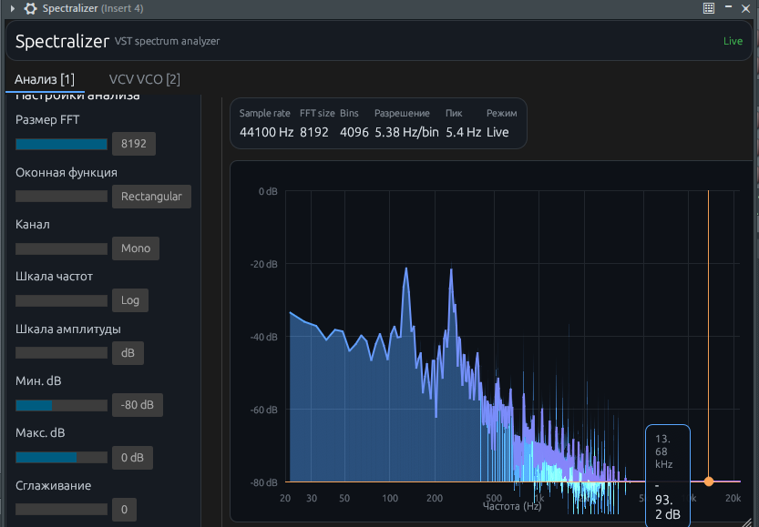

# 🎛️ Spectralizer Wiki

Добро пожаловать в документацию **Spectralizer** — анализатора спектра для файлов и для DAW.

## 📦 Что это?

| Продукт | Описание |
|---------|----------|
| 🖥️ **Desktop** | Electron-приложение: загрузка аудио, спектр, фаза, resynth, VCO |
| 🔌 **VST3 / CLAP** | Плагин real-time анализа на дорожке (pass-through) |

📥 **Скачать:** [Releases](https://github.com/grishinskeo-ship-it/Spectralizer/releases)

## 🗺️ Навигация

- [🖥️ Desktop-приложение](Desktop-приложение)
- [🔌 VST-плагин](VST-плагин)
- [⚙️ Установка и сборка](Установка-и-сборка)
- [⌨️ Горячие клавиши](Горячие-клавиши)
- [❓ FAQ](FAQ)

## ✨ Скриншоты

### Desktop

### VST — вкладка «Анализ»

## 📄 Лицензия

Проект распространяется под **GPL-3.0-or-later**. VST3 использует GPL-совместимые компоненты NIH-plug.
