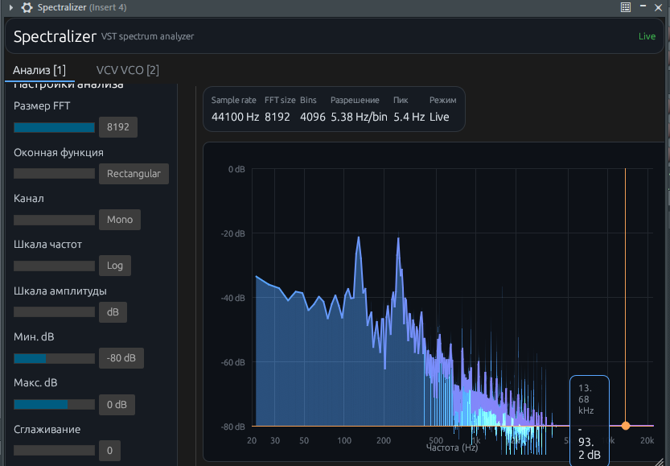

# 🔌 VST-плагин

Real-time **спектроскоп** для DAW: аудио проходит без изменений (analyzer / pass-through).

## ✨ Возможности

### 📊 Анализ

- FFT 256 … 8192  
- Оконные функции, mono / L / R  
- Log/linear частота, dB/linear уровень  
- Сетка, пик, гармоники  
- **Freeze** при Stop транспорта  
- Crosshair + tooltip (Hz, dB)  

### 🎹 VCV VCO

- Fundamental, V/Oct, нота  
- Таблица partials  
- Копирование CSV  

## 🖼️ Скриншот

## 🎛️ FL Studio

1. Установите `.vst3` в `C:\Program Files\Common Files\VST3\`  
2. **F10** → Manage plugins → rescan  
3. **Browser** → VST3 → Spectralizer  

Подробнее: [Установка и сборка](Установка-и-сборка)

## 📦 Форматы

| Формат | Хосты |
|--------|--------|
| **VST3** | FL Studio, Reaper, Cubase, Ableton, … |
| **CLAP** | Bitwig, Reaper 7+, … |

## ⚖️ Лицензия

**GPL-3.0-or-later** (NIH-plug / VST3 SDK bindings).
